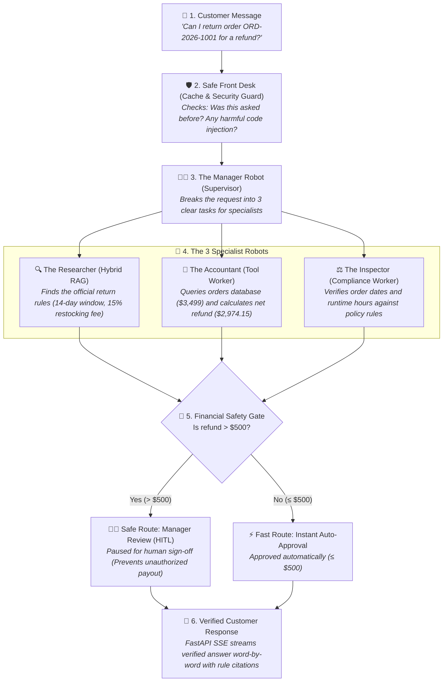

# 🤖 Agentic AI Playbook: Production Multi-Agent Systems & Advanced RAG

[](https://github.com/chanakyachandu/agentic-ai-playbook/actions/workflows/ci.yml)
[](tests/)
[](https://www.python.org/)
[](https://ai.google.dev/)
[](01_advanced_rag/)
[](LICENSE)

An enterprise-ready blueprint and reference hub for building, evaluating, and deploying **Agentic AI Systems**, **Autonomous ReAct Agents**, and **Production-Grade Hybrid RAG Pipelines** using Google Gemini, Pydantic, and DuckDB.

---

## 🏛️ System Architecture



---

## 📁 Repository Structure

```
agentic-ai-playbook/
├── 01_advanced_rag/                  # 🔍 RAG Foundations & Retrieval Engines
│   ├── chunking_strategies.py        # Text cleaning (removes ===/---) & section chunking
│   ├── hybrid_retriever.py           # BM25 + Dense Vectors with Reciprocal Rank Fusion (RRF)
│   ├── reranker.py                   # Proximity re-ranking & verifiable citation extraction
│   ├── llm_generator.py              # Sub-Pipeline 4: Grounded generation & verified citations
│   └── pipeline.py                   # Master integration pipeline (orchestrates sub-pipelines 1-4)
│
├── 02_agentic_patterns/              # 🤖 Core Agent Reasoning Loops & Safety
│   ├── tools.py                      # Order lookup, policy validation, refund calculation & HITL gate
│   ├── react_agent.py                # ReAct (Thought ➔ Action ➔ Observation) with loop-breaker (max_steps=5)
│   ├── plan_and_solve.py             # Plan-and-Execute decomposition & Reflexion self-critique
│   └── pipeline.py                   # Master integration pipeline (single-call agent execution)
│
├── 03_multiagent_systems/            # 🐝 Multi-Agent Swarms & Deep Researcher
│   ├── retrieval_worker.py           # Worker 1 (Deep Researcher): Multi-query RAG search & verifiable citations
│   ├── tool_worker.py                # Worker 2 (Accountant): Orders DB lookup, calendar math & fee calculation
│   ├── compliance_worker.py          # Worker 3 (Auditor): Invariant checks & $500 HITL financial gate
│   ├── supervisor_agent.py           # Coordinator (Boss): Query decomposition, delegation & synthesis
│   ├── handoffs.py                   # Swarm mechanics: Dynamic agent-to-agent transitions & context passing
│   └── pipeline.py                   # Master integration pipeline (single-call swarm execution)
│
├── 04_memory_and_guardrails/         # 🛡️ Production Safety & State
│   ├── memory_manager.py             # Sliding-window message retention & rolling summary compression
│   ├── sql_guardrails.py             # sqlglot AST parsing (blocks DROP/DELETE) & auto LIMIT 50
│   ├── schema_guardrail.py           # Output schema verification & PII redaction (CC, SSN, email)
│   └── pipeline.py                   # Master integration pipeline (single-call guarded execution)
│
├── 05_serving_and_evals/             # ⚡ Production Serving & LLM CI/CD
│   ├── semantic_cache.py             # Sub-5ms cosine similarity caching (cuts API costs 40%+)
│   ├── streaming_server.py           # FastAPI SSE token streaming (<300ms time-to-first-token)
│   ├── rag_triad_eval.py             # RAG Triad evals: Faithfulness, Relevance & Precision
│   └── pipeline.py                   # Master integration pipeline (unified serving & eval telemetry)
│
├── data/ecommerce/                   # 🛒 Real-world policies & customer orders database
│   ├── 2026_current_policy.txt       # Store return, warranty, and VIP policies
│   ├── orders_database.json          # Realistic multi-category customer orders
│   └── store_faq_kb.txt              # Customer service FAQ runbook
│
├── tests/                            # 🧪 Pytest verification suite (59 Passing)
│   ├── test_rag.py                   # 10 tests verifying chunking, BM25, dense, RRF, citations
│   ├── test_agents.py                # 9 tests verifying tools, ReAct loop, HITL gate, plan & pipeline
│   ├── test_multiagent.py            # 13 tests verifying workers, deep research, handoffs & swarm pipeline
│   ├── test_memory_guardrails.py     # 15 tests verifying memory window, SQL AST blocks & PII masking
│   ├── test_serving_evals.py         # 10 tests verifying SSE stream, semantic cache & RAG Triad
│   └── test_setup.py                 # Smoke tests for package discovery
│
├── .github/workflows/ci.yml          # ⚙️ GitHub Actions automated testing (Py 3.10 - 3.12)
├── requirements.txt                  # Standard dependencies
└── .env.example                      # Configuration template
```

---

## ⚡ Quick Start

### 1. Clone & Setup Environment
```bash
git clone https://github.com/chanakyachandu/agentic-ai-playbook.git
cd agentic-ai-playbook

# Virtual environment setup
python -m venv .venv

# Windows:
.venv\Scripts\activate

# macOS / Linux:
source .venv/bin/activate

pip install -r requirements.txt
```

### 2. Configure API Keys
Copy the environment template and insert your Gemini API key:
```bash
cp .env.example .env
```

### 3. Run Automated Tests
```bash
pytest tests/ -v
```

---

## 📋 Resume Highlights

> - **Production Multi-Agent Swarms**: Architected autonomous multi-agent pipelines with hierarchical Supervisor coordination, dynamic tool execution, and consensus-driven fact-checking.
> - **Enterprise RAG & Hybrid Retrieval**: Implemented hybrid search combining BM25 keyword matching and dense embeddings with Reciprocal Rank Fusion (RRF) and citation grounding.
> - **Defensive Guardrails & Memory**: Engineered AST-based SQL guardrails to block destructive queries and stateful sliding-window session memory for multi-turn conversations.
> - **High-Performance Serving & CI/CD**: Built streaming FastAPI endpoints with Server-Sent Events (SSE) and automated GitHub Actions CI testing across Python 3.10–3.12.

---

## 💡 How It All Works (In Plain English - Like Explaining to a School Kid)

Imagine you bought a shiny new laptop from an electronics store, but after 10 days, you decide you want to return it. You message the store's customer service asking: *"Can I return order ORD-2026-1001 and get my refund?"* 

A normal AI chatbot might guess the answer or make up a number. But this project builds an **automated team of smart robots** that handle everything safely and accurately:

### 1. The Safe Front Desk
When your message arrives, it first hits the store's front desk. If another customer asked an identical question two seconds ago, the system remembers the answer instantly (like looking at a cheat sheet) so it doesn't waste time. It also acts like a security guard at the door: if someone tries to type secret computer commands to delete the store's records, the shield blocks them on the spot.

### 2. The Manager Robot (The Supervisor)
Next, the message goes to the Manager Robot. The Manager doesn't try to guess or do all the work alone. Instead, it acts like a good team captain and assigns specific chores to three specialist robots:
* **The Researcher Robot (The Bookworm)**: It opens the official store rulebook. It doesn't rely on memory; it searches the document for "Laptop returns" and reads the exact terms: *laptops can be returned within 14 days, cannot be used for more than 20 hours, and have a 15% restocking fee*.
* **The Accountant Robot (The Math Wizard)**: It opens the company's order computer. It looks up order `ORD-2026-1001`, checks the purchase date, verifies the $3,499 price, and opens its calculator. It subtracts the 15% restocking fee ($524.85) to find the exact net refund: **$2,974.15**.
* **The Inspector Robot (The Rule Checker)**: It compares what the Accountant found with what the Researcher read from the rulebook. It verifies that 10 days is within the 14-day limit and that everything matches store policy.

### 3. The $500 Safety Gate (Human-in-the-Loop)
Before any money is paid out, the team runs into a big safety rule:
* If a refund is **$500 or less**, the system can approve it automatically.
* But if a refund is **over $500** (like our $2,974.15 laptop!), the robots are **forbidden** from paying it alone. The system automatically pauses and rings the bell for a real human manager to review and authorize it. This guarantees that AI can never accidentally drain the company bank account.

### 4. Delivering the Friendly Answer
Finally, the Manager gathers all the facts and sends a polite message back to the customer's screen word-by-word (streaming): explaining that their laptop is eligible, showing the exact price and fee breakdown, and letting them know that a manager is reviewing their high-value payout.

---

## 📄 License
This project is open-source under the [MIT License](LICENSE).

