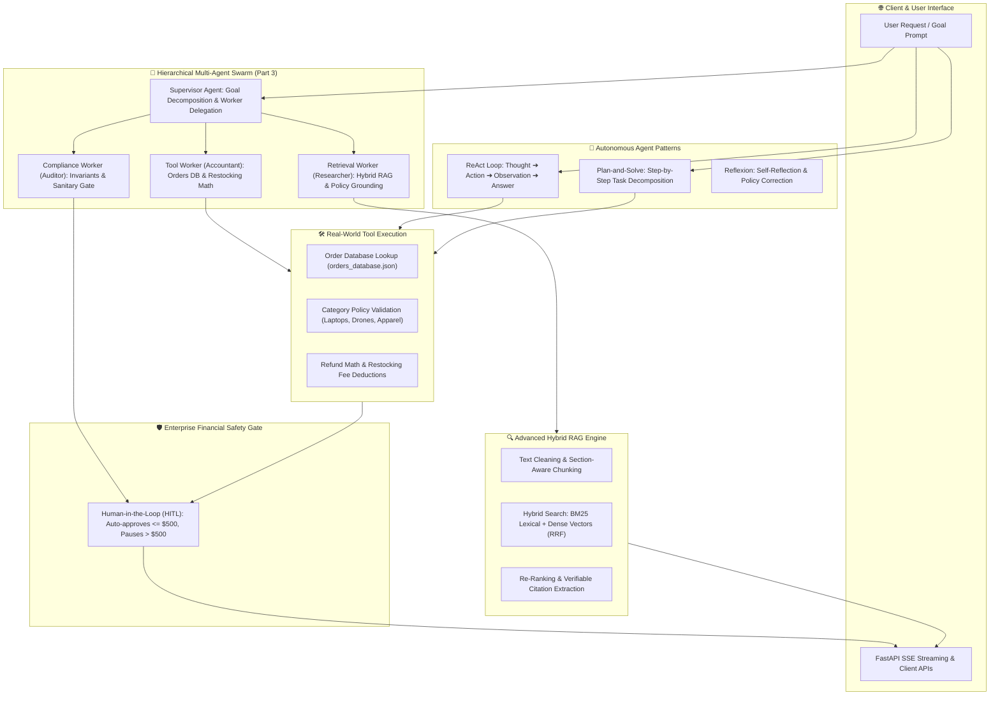

# 🤖 Agentic AI Playbook: Production Multi-Agent Systems & Advanced RAG

[](https://github.com/chanakyachandu/agentic-ai-playbook/actions/workflows/ci.yml)
[](tests/)
[](https://www.python.org/)
[](https://ai.google.dev/)
[](01_advanced_rag/)
[](LICENSE)

An enterprise-ready blueprint and reference hub for building, evaluating, and deploying **Agentic AI Systems**, **Autonomous ReAct Agents**, and **Production-Grade Hybrid RAG Pipelines** using Google Gemini, Pydantic, and DuckDB.

---

## 🏛️ System Architecture



---

## 📁 Repository Structure

```
agentic-ai-playbook/
├── 01_advanced_rag/                  # 🔍 RAG Foundations & Retrieval Engines
│   ├── chunking_strategies.py        # Text cleaning (removes ===/---) & section chunking
│   ├── hybrid_retriever.py           # BM25 + Dense Vectors with Reciprocal Rank Fusion (RRF)
│   ├── reranker.py                   # Proximity re-ranking & verifiable citation extraction
│   ├── llm_generator.py              # Sub-Pipeline 4: Grounded generation & verified citations
│   └── pipeline.py                   # Master integration pipeline (orchestrates sub-pipelines 1-4)
│
├── 02_agentic_patterns/              # 🤖 Core Agent Reasoning Loops & Safety
│   ├── tools.py                      # Order lookup, policy validation, refund calculation & HITL gate
│   ├── react_agent.py                # ReAct (Thought ➔ Action ➔ Observation) with loop-breaker (max_steps=5)
│   ├── plan_and_solve.py             # Plan-and-Execute decomposition & Reflexion self-critique
│   └── pipeline.py                   # Master integration pipeline (single-call agent execution)
│
├── 03_multiagent_systems/            # 🐝 Multi-Agent Swarms & Deep Researcher
│   ├── retrieval_worker.py           # Worker 1 (Deep Researcher): Multi-query RAG search & verifiable citations
│   ├── tool_worker.py                # Worker 2 (Accountant): Orders DB lookup, calendar math & fee calculation
│   ├── compliance_worker.py          # Worker 3 (Auditor): Invariant checks & $500 HITL financial gate
│   ├── supervisor_agent.py           # Coordinator (Boss): Query decomposition, delegation & synthesis
│   ├── handoffs.py                   # Swarm mechanics: Dynamic agent-to-agent transitions & context passing
│   └── pipeline.py                   # Master integration pipeline (single-call swarm execution)
│
├── 04_memory_and_guardrails/         # 🛡️ Production Safety & State
│   ├── memory_manager.py             # Sliding-window message retention & rolling summary compression
│   ├── sql_guardrails.py             # sqlglot AST parsing (blocks DROP/DELETE) & auto LIMIT 50
│   ├── schema_guardrail.py           # Output schema verification & PII redaction (CC, SSN, email)
│   └── pipeline.py                   # Master integration pipeline (single-call guarded execution)
│
├── 05_serving_and_evals/             # ⚡ Production Serving & LLM CI/CD
│   ├── semantic_cache.py             # Sub-5ms cosine similarity caching (cuts API costs 40%+)
│   ├── streaming_server.py           # FastAPI SSE token streaming (<300ms time-to-first-token)
│   ├── rag_triad_eval.py             # RAG Triad evals: Faithfulness, Relevance & Precision
│   └── pipeline.py                   # Master integration pipeline (unified serving & eval telemetry)
│
├── data/ecommerce/                   # 🛒 Real-world policies & customer orders database
│   ├── 2026_current_policy.txt       # Store return, warranty, and VIP policies
│   ├── orders_database.json          # Realistic multi-category customer orders
│   └── store_faq_kb.txt              # Customer service FAQ runbook
│
├── tests/                            # 🧪 Pytest verification suite (59 Passing)
│   ├── test_rag.py                   # 10 tests verifying chunking, BM25, dense, RRF, citations
│   ├── test_agents.py                # 9 tests verifying tools, ReAct loop, HITL gate, plan & pipeline
│   ├── test_multiagent.py            # 13 tests verifying workers, deep research, handoffs & swarm pipeline
│   ├── test_memory_guardrails.py     # 15 tests verifying memory window, SQL AST blocks & PII masking
│   ├── test_serving_evals.py         # 10 tests verifying SSE stream, semantic cache & RAG Triad
│   └── test_setup.py                 # Smoke tests for package discovery
│
├── .github/workflows/ci.yml          # ⚙️ GitHub Actions automated testing (Py 3.10 - 3.12)
├── requirements.txt                  # Standard dependencies
└── .env.example                      # Configuration template
```

---

## ⚡ Quick Start

### 1. Clone & Setup Environment
```bash
git clone https://github.com/chanakyachandu/agentic-ai-playbook.git
cd agentic-ai-playbook

# Virtual environment setup
python -m venv .venv

# Windows:
.venv\Scripts\activate

# macOS / Linux:
source .venv/bin/activate

pip install -r requirements.txt
```

### 2. Configure API Keys
Copy the environment template and insert your Gemini API key:
```bash
cp .env.example .env
```

### 3. Run Automated Tests
```bash
pytest tests/ -v
```

---

## 📋 Resume Highlights

> - **Production Multi-Agent Swarms**: Architected autonomous multi-agent pipelines with hierarchical Supervisor coordination, dynamic tool execution, and consensus-driven fact-checking.
> - **Enterprise RAG & Hybrid Retrieval**: Implemented hybrid search combining BM25 keyword matching and dense embeddings with Reciprocal Rank Fusion (RRF) and citation grounding.
> - **Defensive Guardrails & Memory**: Engineered AST-based SQL guardrails to block destructive queries and stateful sliding-window session memory for multi-turn conversations.
> - **High-Performance Serving & CI/CD**: Built streaming FastAPI endpoints with Server-Sent Events (SSE) and automated GitHub Actions CI testing across Python 3.10–3.12.

---

## 📄 License
This project is open-source under the [MIT License](LICENSE).
